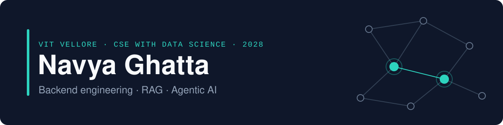

  

<b>Open to SDE / SWE internships</b> &nbsp;|&nbsp; Ahmedabad, India

## About me

I'm a pre-final year Computer Science student at VIT Vellore, specialising in Data Science. I like building systems where an LLM has to work with real data: fetch the right evidence, reason over it, and give an answer you can check.

Most of what I build sits on the backend: REST APIs, retrieval pipelines and multi-agent workflows, with enough frontend to make them usable. Right now I'm exploring RAG architectures and distributed systems, and keeping up steady DSA practice.

## Featured projects

| Project | What it does | Built with |
|---|---|---|
| [**GenAI AWS Incident Diagnosis**](https://github.com/navya906/incident-diagnosis-aws) | First-pass AWS incident investigation. Pulls CloudWatch metrics, logs and CloudTrail events, flags anomalies with 5 statistical detectors, retrieves similar past incidents, and has an LLM write a root-cause diagnosis where every claim cites verified evidence. 390+ backend tests and a 6-job CI pipeline. | Python, FastAPI, pgvector, React, TypeScript, Docker |
| [**Semantic AI Job Search Engine**](https://github.com/navya906/semantic-job-search) | Search for jobs in plain language. 15,000 listings indexed as 384-dimensional embeddings in FAISS, behind a Flask backend with authentication and role-based access. | Python, Flask, MySQL, SentenceTransformers, FAISS |
| **SETU** | Multilingual platform (Hindi, Marathi, Tamil, English) where unorganized-sector workers create a professional profile by voice or text, with explainable job matching and a recruiter portal. Top 3 overall and "Ready-to-Launch" award at the LinkedIn CoachIn 2026 hackathon. | Team of 5 |
| [**MediClear**](https://github.com/navya906/mediclear) | Reads a lab report (PDF or scan) and explains the results in plain language. Not a diagnostic tool. | FastAPI, React, Tesseract OCR, Supabase |

## Tech stack

 
 
 
 
 

## Experience

- **Vice Chairperson, IEEE Computer Society, VIT**  Previously senior and junior core.
- **LinkedIn CoachIn 2026 Mentee.** Selected from 21,000+ applicants for 1:1 mentorship; built SETU in the programme's hackathon.
- **Contributor, GSSoC '26.**
- **Python Developer Intern, Cybercom Creation** (Jun 2025). Built full-stack Flask applications with authentication, role-based access control, REST APIs and MySQL.

## Recognition

- Top 3 overall and "Ready-to-Launch" award, LinkedIn CoachIn 2026 Internal Hackathon (SETU)
- Track Prize, Yantra Central Hackathon, VIT Vellore (VAYU AI)
- 150+ DSA problems solved on LeetCode

## Education

**Vellore Institute of Technology, Vellore.** BTech, Computer Science and Engineering with Data Science, 2024 to 2028.

## Connect

[LinkedIn](https://www.linkedin.com/in/navya-ghatta) &nbsp;|&nbsp; [Email](mailto:navyaghatta@gmail.com)
